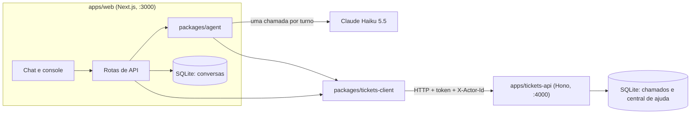

# Nexo Assist

Agent de atendimento do service desk de TI da Nexo. O funcionário descreve o problema num chat, e o agent consulta os chamados dele, busca na central de ajuda, propõe abrir, complementar ou reabrir um chamado e chama um analista quando precisa. O analista acompanha tudo num console, assume a conversa e devolve ao agent quando terminar.

Cada resposta do agent mostra o que ele fez ("✓ consultou seus chamados", "✓ verificou duplicidade") e, em "por quê?", o que entendeu, as regras aplicadas, a confiança e a justificativa.

- [Como rodar](#como-rodar)
- [Arquitetura](#arquitetura)
- [Como o agent decide](#como-o-agent-decide)
- [Qualidade das decisões](#qualidade-das-decisões)
- [Modelo e custo](#modelo-e-custo)
- [Decisões e trade-offs](#decisões-e-trade-offs)
- [O que faria com mais tempo](#o-que-faria-com-mais-tempo)

## Como rodar

Requisitos: Node.js 22+ e pnpm 10+.

```bash
pnpm install
cp .env.example .env   # preencha ANTHROPIC_API_KEY; o resto já tem valor padrão
pnpm dev               # app em http://localhost:3000 e serviço de chamados em :4000
```

A chave do Claude é criada em [platform.claude.com](https://platform.claude.com) (a API é cobrada à parte do plano do claude.ai). No `.env`, troque também `SESSION_SECRET` e `TICKETS_API_TOKEN` por valores aleatórios.

Na primeira subida, os bancos SQLite são criados sozinhos: o de chamados em `apps/tickets-api/data/`, com funcionários, artigos da central de ajuda e chamados de exemplo, e o de conversas em `apps/web/data/`. As datas do exemplo são relativas ao momento do seed, então as situações (chamado vencido, resolvido há 4 dias) continuam valendo. Para reiniciar o relógio:

```bash
pnpm --filter @nexo/tickets-api db:reset
```

Outros comandos:

```bash
pnpm check    # typecheck, lint, formatação e testes (sem rede, sem chave)
pnpm evals    # cenários contra o modelo de verdade (usa a chave; ver Qualidade)
```

### Usuários de exemplo

Qualquer senha é aceita.

| E-mail                      | Papel                    | Para ver                                                  |
| --------------------------- | ------------------------ | --------------------------------------------------------- |
| `ana.souza@nexo.com.br`     | Funcionária (Financeiro) | Chamado vencido, chamado para reabrir, vários abertos     |
| `bruno.tavares@nexo.com.br` | Funcionário (Comercial)  | Outro funcionário: a Ana não vê os chamados dele          |
| `rafael.lima@nexo.com.br`   | Analista Suporte N2      | Console: casos críticos, altos e vencidos caem na fila N2 |
| `juliana.costa@nexo.com.br` | Analista Suporte N1      | Console: pedidos de analista e baixa confiança na fila N1 |

Um roteiro curto com a Ana: "Minha VPN dá erro 809 no Windows 10" (resposta pela central de ajuda), "Como está meu chamado do notebook?" (vencido, oferece analista), "Quero falar com um analista" (transfere). Depois, entre como Rafael ou Juliana em outra janela anônima e assuma a conversa.

## Arquitetura



| Pacote                    | Papel                                                                              |
| ------------------------- | ---------------------------------------------------------------------------------- |
| `apps/web`                | App Next.js: login, chat do funcionário, console do analista e banco das conversas |
| `apps/tickets-api`        | Sistema de chamados "legado" simulado (Hono + SQLite), com quedas e latência       |
| `packages/agent`          | Um turno do agent: contexto, interpretação pelo LLM, política, trace               |
| `packages/domain`         | Regras do Anexo A: prioridade, prazos em horas úteis, duplicidade, transferência   |
| `packages/shared`         | Vocabulário do service desk, partes das mensagens e contrato da API (schemas Zod)  |
| `packages/tickets-client` | Cliente tipado do sistema de chamados, com timeout, retry e chave de idempotência  |
| `packages/sqlite`         | Abertura do SQLite (libsql) com migrações versionadas, usada pelos dois bancos     |
| `packages/evals`          | Cenários de conversa rodados contra o LLM de verdade, com relatório                |

As regras do service desk ficam em `domain`, sem dependência de LLM, banco ou HTTP, e por isso são testadas isoladamente. O agent não conhece o Next.js, e o app web não conhece o prompt: o contrato entre os dois é `runTurn` e `confirmDraft`, que recebem dados e devolvem partes da mensagem e o trace.

### Serviço de chamados simulado

- **Separado do agent:** roda em outra porta e só aceita chamadas com o token compartilhado (`TICKETS_API_TOKEN`).
- **Privacidade no próprio serviço:** toda chamada informa em nome de quem é feita (`X-Actor-Id`). Funcionário só vê os próprios chamados; o chamado de outra pessoa responde 404, como se não existisse. Analista vê todos.
- **Instável de propósito:** `TICKETS_FAILURE_RATE` derruba o serviço por `TICKETS_OUTAGE_SECONDS` segundos, respondendo 503 com `Retry-After`. A central de ajuda não é afetada.
- **Retry seguro:** o cliente repete o pedido com backoff exponencial e respeita o `Retry-After`. Escritas levam uma `Idempotency-Key`; se a resposta se perder e o pedido for repetido, o serviço devolve o resultado original em vez de criar um chamado duplicado. Quando o retry acontece, ele aparece no chip do agent ("2 tentativas").

### App web

- **Sessão:** JWT assinado (HS256) num cookie `httpOnly`. "Manter conectado" vale por 30 dias; sem ele, o cookie some ao fechar o navegador.
- **Autorização em duas camadas:** o `proxy.ts` faz a checagem otimista (sem sessão vai para o login, funcionário não entra no console e vice-versa), e cada página e ação refaz a checagem em `server/auth.ts`, perto dos dados. O id do funcionário vem sempre da sessão, nunca do navegador nem do LLM.
- **Estado da conversa:** a máquina de estados fica no domínio (`agente → aguardando_analista → com_analista → agente | encerrada`). O banco só grava transições que ela aceita, e a gravação é condicionada ao estado lido, então dois analistas assumindo ao mesmo tempo não dão conflito silencioso.
- **Resposta em streaming:** a mensagem vai para `POST /api/chat/messages`, que responde em NDJSON. Cada passo do agent chega ao navegador assim que acontece e vira um chip acima da resposta.
- **Rascunho confirmado no servidor:** Confirmar, Editar e Cancelar mandam só o id do rascunho; os dados vêm do banco, não do navegador. A edição muda texto e categoria, mas a prioridade e o prazo continuam os das regras. Um compare-and-swap na mensagem garante que um duplo clique não cria dois chamados.
- **Com um analista, o agent se cala:** as mensagens do funcionário só ficam registradas, e a tela consulta o servidor a cada 3 s para mostrar as respostas do analista.
- **Limite de 30 mensagens por conversa** (`MAX_MESSAGES_PER_SESSION`), checado no servidor. Ao chegar no limite, "Nova conversa" encerra a atual; os chamados continuam.
- **Console do analista (`/console`):** lista de conversas com busca e filtros (Todas, Para você = fila do nível do analista, Com o agent, Minhas), a conversa no centro e os chamados do funcionário à direita. Na conversa transferida aparece o motivo, o resumo do agent e a confiança. O analista assume (o agent pausa e o chamado em foco vai para "Em atendimento"), responde, devolve ao agent ou encerra; cada ação vira um evento na conversa, visível para os dois lados. Só quem assumiu responde, devolve ou encerra.

## Como o agent decide

O princípio é **o LLM interpreta, o código decide**. O modelo é bom para entender "meu Outlook não abre e tenho reunião com cliente às 15h"; já "isso é prioridade Alta com prazo de 4 horas úteis" é regra de negócio e tem de dar sempre o mesmo resultado. Cada turno (`packages/agent/src/turn.ts`) tem quatro passos:

1. **Contexto, sem LLM.** Busca os chamados do funcionário (abertos e resolvidos há até 7 dias, já com o prazo calculado) e os artigos da central de ajuda relacionados à mensagem.
2. **Uma chamada ao LLM**, com saída estruturada (schema Zod `TurnDecision`). O modelo devolve a intenção, um resumo, a confiança, a justificativa, a ação sugerida (responder, perguntar, listar ou mostrar chamado, propor chamado, propor complemento, transferir, redirecionar), o texto da resposta e os fatos que extraiu (tipo, categoria, quem é afetado, se impede de trabalhar, se há compromisso hoje). Uma saída fora do schema conta como falha e a chamada é repetida.
3. **A política aplica as regras** (`policy.ts`, com as regras puras em `packages/domain`) e decide o que de fato acontece. Quando a regra muda a ação sugerida, a resposta também passa a ser escrita pelo código, para nunca contradizer o que foi feito.
4. **O trace registra** o que foi entendido, cada ação (com status e número de tentativas), as regras aplicadas, a confiança, a justificativa, o modelo, os tokens e a latência. É o mesmo registro que alimenta os chips, o painel "por quê?" e o cartão de transferência no console.

| Regra (Anexo A e PRD)           | Quem decide                                                                                                                                                                                                               |
| ------------------------------- | ------------------------------------------------------------------------------------------------------------------------------------------------------------------------------------------------------------------------- |
| Prioridade e prazo              | Código, a partir dos fatos extraídos: equipe ou empresa parada é Crítica (1 h); uma pessoa impedida ou compromisso hoje é Alta (4 h úteis); requisição sem urgência é Baixa (5 dias úteis); o resto, Média (3 dias úteis) |
| Prazo em horas úteis            | Código: seg–sex, 8h–18h, horário de Brasília                                                                                                                                                                              |
| Sem duplicidade                 | Código: antes de criar, procura chamado aberto parecido (complementa) ou resolvido há até 7 dias (reabre)                                                                                                                 |
| Quem é afetado                  | Código: sem essa informação não há chamado; o agent pergunta com opções rápidas                                                                                                                                           |
| Confirmação antes de agir       | Código: o agent só propõe um rascunho; nada é criado sem o funcionário confirmar                                                                                                                                          |
| Transferência                   | Código: pedido do funcionário, caso crítico ou confiança abaixo de 60% transferem; chamado vencido gera a oferta "quer que eu chame um analista?"                                                                         |
| Nível do analista               | Código: crítico, alto ou vencido vai para o Suporte N2; o resto para o N1                                                                                                                                                 |
| Privacidade                     | Serviço de chamados (404 para chamado de outra pessoa) e código (só os chamados do funcionário entram no prompt; pergunta por chamado alheio recebe a resposta da privacidade)                                            |
| Escopo só de TI                 | LLM identifica; o código registra a regra e a resposta redireciona                                                                                                                                                        |
| Responder pela central de ajuda | LLM, a partir dos artigos encontrados; o artigo usado fica no trace                                                                                                                                                       |
| Sistema de chamados fora do ar  | Código: nenhuma ação sobre chamados sem consultar antes; o funcionário recebe "tentar de novo"                                                                                                                            |
| Falha do modelo                 | Código: avisa e não age (não transfere sozinho, para não lotar a fila por instabilidade)                                                                                                                                  |

## Qualidade das decisões

Duas camadas, cada uma para um tipo de erro:

- **Testes (`pnpm test`, 115 testes):** as regras do Anexo A (prioridade, prazo em horas úteis, duplicidade, reabertura, transferência), a política do agent com um modelo fixo no lugar do LLM, o cliente com quedas e retry, o serviço de chamados (privacidade, idempotência) e a máquina de estados da conversa. Rodam sem rede e sem chave.
- **Avaliações (`pnpm evals`):** 17 cenários rodados contra o modelo de verdade, cada um com um funcionário do seed e o resultado esperado: dúvida resolvida pela central, Windows 10 x Windows 11, chamado duplicado, reabertura em até 7 dias e recusa depois disso, fora de escopo, chamado de outra pessoa (pelo número e pelo nome), tentativa de contornar as regras, chamado vencido, pedido de analista, as prioridades, requisição x incidente, mensagem vaga e saudação.

As avaliações conferem o que o funcionário recebe e o que foi feito (rascunho, alvo, prioridade, transferência, regras registradas no trace), não o texto livre do modelo. Em todo turno também conferem que nada dos chamados de outras pessoas aparece na resposta. Cada execução tem o próprio banco de chamados temporário.

```bash
pnpm evals                       # todos os cenários, uma vez
pnpm evals --runs 3              # três vezes cada, para medir estabilidade
pnpm evals --only vencido,ambiguo
```

O último resultado fica em [packages/evals/RESULTADOS.md](packages/evals/RESULTADOS.md): 51 de 51 execuções passaram. A primeira rodada achou dois problemas reais, já corrigidos: perguntar pelo chamado de um colega deixava o modelo inseguro e o agent transferia para um analista em vez de responder pela regra de privacidade; e um problema que voltou fazia o agent perguntar "quem é afetado?" antes de ver que dava para reabrir o chamado resolvido.

## Modelo e custo

O agent usa o **Claude Haiku 5.5**. Cada turno é uma única chamada de interpretação com saída estruturada, e as regras pesadas ficam no código, então o trabalho do modelo é entender português informal e escolher entre poucas ações. Um modelo pequeno e rápido dá conta, e as avaliações mostram isso com 51/51.

- **Latência:** cerca de 2 s por turno nas avaliações. O raciocínio estendido fica desligado, porque a decisão difícil não está no modelo. Cada tentativa tem timeout de 9 s, com uma repetição.
- **Custo:** nas avaliações, um turno usou em média 3,9 mil tokens de entrada (instruções, chamados do funcionário, artigos e histórico) e 330 de saída. A US$ 0,10 e US$ 0,50 por milhão, isso dá cerca de US$ 0,0006 por turno. Uma conversa típica de 5 a 10 mensagens custa menos de um centavo de dólar, e mesmo o limite de 30 mensagens fica perto de US$ 0,01.
- **Contenção:** o histórico enviado ao modelo é limitado às últimas 16 mensagens, a central de ajuda manda só os 3 artigos mais relevantes, e o limite de mensagens por conversa é checado no servidor.

O modelo é configurável por `LLM_MODEL` no formato do Mastra (`provedor/modelo`). O projeto começou com o Gemini Flash, e trocar para o Claude foi só mudar a variável e a chave. Por exemplo, `google/gemini-3.5-flash` com `GOOGLE_GENERATIVE_AI_API_KEY` também funciona; os ajustes por provedor (raciocínio, temperatura) ficam em `interpreter.ts`.

## Decisões e trade-offs

- **Uma chamada ao LLM por turno, em vez de um agent com tool calling livre.** O contexto (chamados e artigos) é carregado antes, e o modelo só interpreta. Perde-se a flexibilidade de o modelo decidir o que consultar, mas ganha-se latência previsível, custo baixo e regras que não dependem de o modelo lembrar de chamar a tool certa. As "tools" continuam existindo como passos do código, registrados no trace.
- **Regras em código, prompt como orientação.** O prompt descreve as regras para o modelo acertar de primeira, mas a política aplica de novo. Se o modelo sugerir prioridade errada ou um chamado duplicado, o código corrige. O custo é ter as regras descritas em dois lugares.
- **Serviço de chamados separado, com falhas simuladas.** Mais código do que um módulo dentro do Next, mas força o contrato HTTP real (token, ator, 404 de privacidade, 503 com `Retry-After`, idempotência) e mostra como o agent se comporta quando o legado cai.
- **SQLite nos dois bancos.** Zero configuração para rodar localmente e persistência entre reinícios. Para muitos analistas escrevendo ao mesmo tempo, o próximo passo seria Postgres; as migrações versionadas e o Drizzle facilitam a troca.
- **Consulta a cada 3 s em vez de WebSocket.** Simples, funciona em qualquer hospedagem e basta para o volume de um service desk. O streaming fica onde mais importa: a resposta do agent.
- **Busca léxica na central de ajuda.** Com dezenas de artigos, pontuar em memória é instantâneo e explicável (a pontuação aparece no trace). Com milhares, seria FTS5 ou embeddings.
- **Login sem senha real.** O desafio é o agent; a sessão é de verdade (JWT assinado, `httpOnly`, autorização no servidor), mas qualquer senha é aceita para os usuários do seed.
- **Cache Components desligado.** Quase toda tela depende do usuário logado, então o cache de páginas estáticas do Next 16 traria complexidade sem ganho.

## O que faria com mais tempo

- **Avaliações no CI**, com um orçamento de custo por execução, e mais cenários vindos de conversas reais (anonimizadas), principalmente as transferidas por baixa confiança.
- **Server-Sent Events** no console e no chat com analista, no lugar da consulta a cada 3 s, e contador de não lidas na lista do console.
- **Busca semântica** na central de ajuda e sugestão de artigo para o analista no console.
- **Métricas de operação:** taxa de resolução pelo agent, transferências por motivo, tempo até o analista assumir, custo por conversa, tudo a partir do trace que já é gravado.
- **Postgres e fila de eventos** entre o app e o sistema de chamados, para não depender de o legado estar no ar no momento da ação.
- **Login real** (SSO da empresa) e limite de uso por usuário e global, necessário antes de abrir para 2.000 funcionários.
- **Acessibilidade e celular:** as telas seguem o protótipo de desktop; faltam o layout responsivo e uma revisão de leitor de tela.
